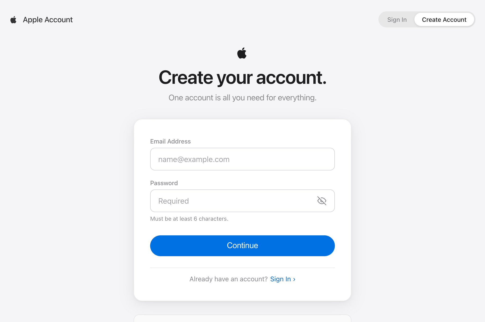
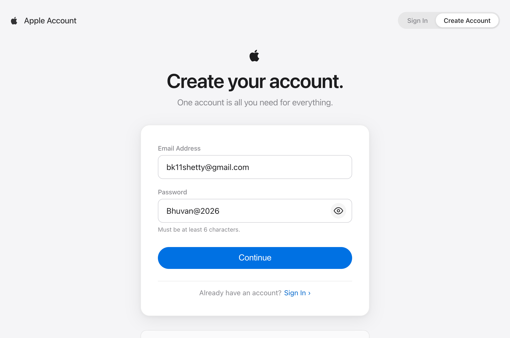
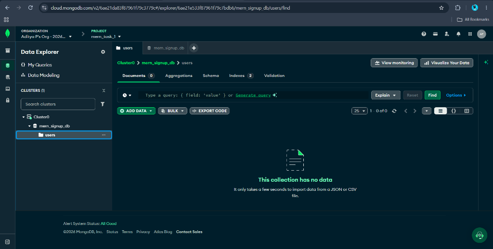
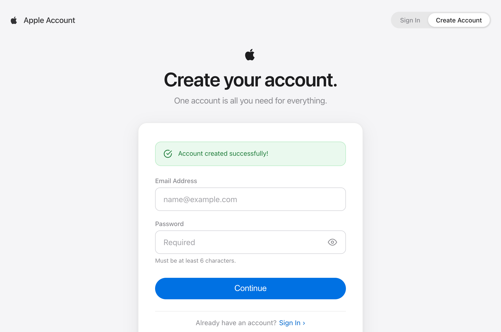
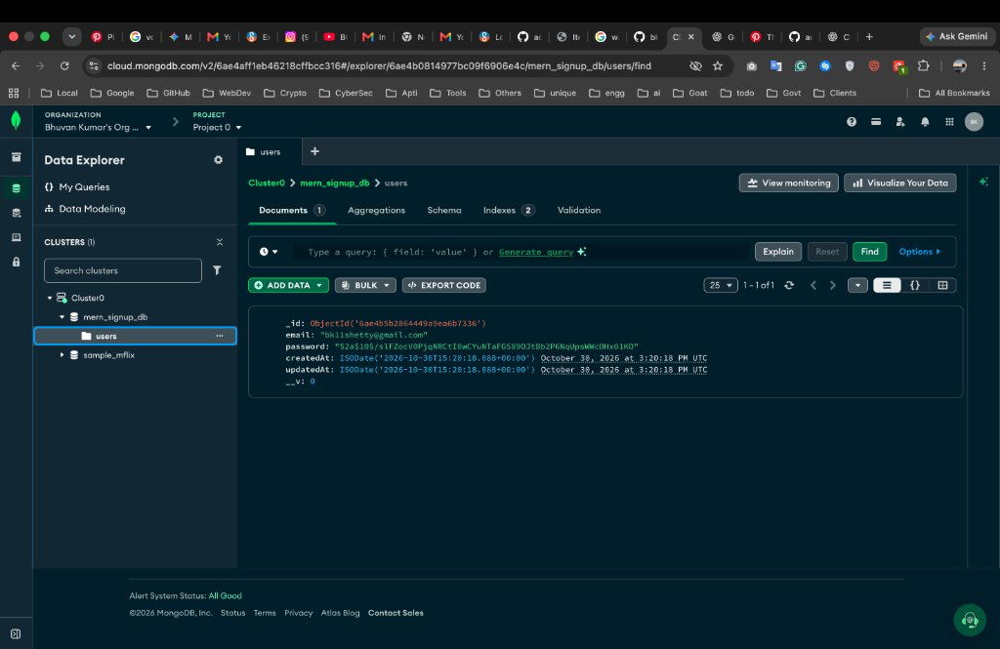
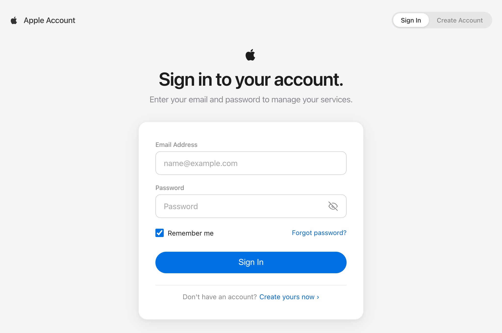
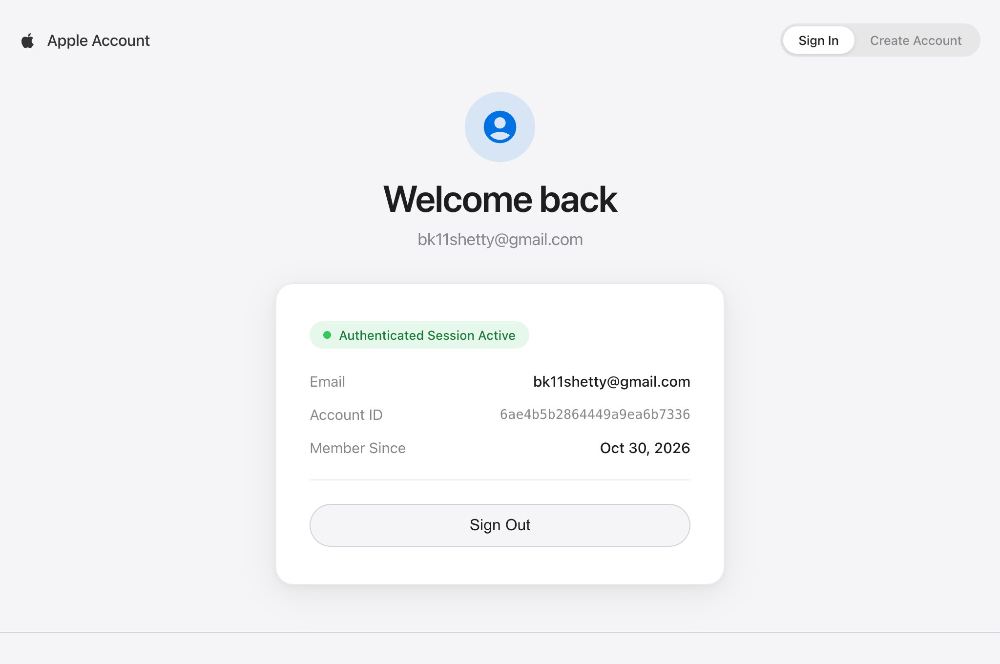

# MERN Stack - User Authentication System (Task 2)

A full-stack user registration and authentication system built using the **MERN** stack (MongoDB Atlas, Express.js, React + Vite, Node.js) with password hashing via `bcryptjs` and a modern UI inspired by the **Apple Design System** ("Product-tile whiteout").

---

## Features

- **Apple Design System**: Minimalist industrial design with `#F5F5F7` background, elevated pure white card surfaces, SF Pro typography, and Apple blue pill CTAs (`#0071E3`).
- **User Registration (Sign Up)**: Input validation, email normalization, duplicate account prevention, and secure password hashing using `bcryptjs` (10 salt rounds).
- **User Authentication (Sign In)**: Secure credential verification against MongoDB Atlas with active session overview and Sign Out.
- **Interactive UI**: Show/hide password visibility toggle, responsive layout, and Apple-styled feedback banners.
- **MongoDB Atlas Cloud Database**: Cloud-hosted database connection with DNS SRV resolution.

---

## Output & Screenshots

### 1. Create Account Page (Sign Up)
Apple-style clean registration interface with segmented auth controls and subtle elevation.


---

### 2. Inputting User Credentials
User entering email (`bk11shetty@gmail.com`) and secure password with visibility toggle.


---

### 3. MongoDB Atlas Collection Before Registration
MongoDB Atlas database (`mern_signup_db -> users`) showing the collection before registration.


---

### 4. Output After Pressing Continue
The React UI displaying the Apple-styled success notification banner (**"Account created successfully!"**) after the REST API processes the registration.


---

### 5. MongoDB Atlas After Registration (Data Stored)
MongoDB Atlas Data Explorer showing the newly created user document (`bk11shetty@gmail.com`) stored in the cloud with timestamps and encrypted password hash (`bcrypt`).


---

### 6. Apple Sign In Page
Clean, focused authentication interface for returning users with Remember Me and password recovery options.


---

### 7. Authenticated User Session Active
Verified user profile card displaying authenticated account details, Account ID, and Sign Out control.


---

## How to Run Locally

### 1. Setup Backend
```bash
cd backend
npm install
# Configure your MongoDB URI in backend/.env (refer to backend/.env.example)
npm run dev
```
Server starts on `http://localhost:5001`.

### 2. Setup Frontend
```bash
cd frontend
npm install
npm run dev
```
Client starts on `http://localhost:5173`.

---

## Author
**Bhuvan Kumar Shetty** ([@bkshetty](https://github.com/bkshetty))
